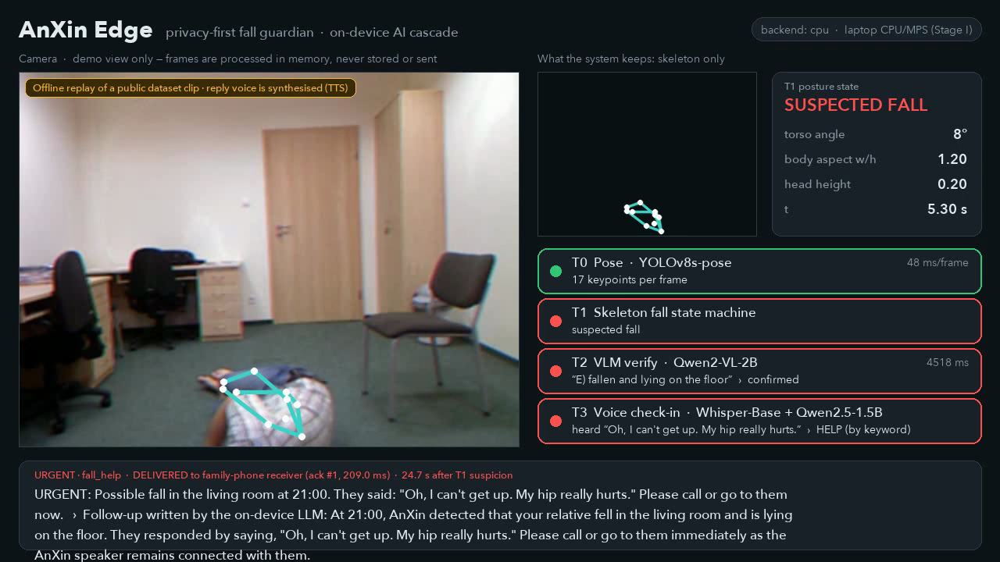
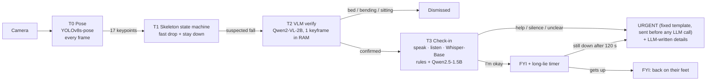

# AnXin Edge (安心) — privacy-first fall guardian, designed for the ASUS UGen300

> **ASUS UGen AI League 2026 · Everyday AI · Battlefield Lightning (UGen300 / Hailo-10H)**

AnXin Edge watches over older adults who live alone. It detects a fall, **verifies** it, **asks the person** whether they are okay, **delivers a text-only alert** with a receipt, and escalates if the person stays on the floor (the "long lie").
**Stage I status:** the whole loop runs on a laptop (CPU/MPS). The UGen300 backend is written but has **not yet been run on hardware**; that is Stage II.



## Status

| Capability | Status | Evidence |
|---|---|---|
| Pose + skeleton fall state machine | verified offline | URFD 70 clips, side camera |
| VLM verification (Qwen2-VL-2B) | verified offline | false alarms 20 → 2 of 40 |
| Voice check-in: speak, listen, Whisper, rules + LLM | verified offline | 84 synthetic replies; mic input coded, not user-tested |
| Alert delivery: HTTP webhook, receipt, retry, local siren | implemented | tested with the local receiver; Telegram adapter untested |
| Long-lie escalation | implemented | unit tests + demo with the timer shortened to 1 s |
| No raw-frame retention | implemented | `tests/test_privacy.py`: ≤ 2 frames in RAM at any time |
| UGen300 backend (`--backend hailo`) | code only | adapted from ugen300-demos, never run on hardware |
| Latency/power on UGen300, multi-person, user acceptance | Stage II | not measured / not validated |

## How it works



* **Escalation is rule-based.** A non-negated distress word ("hurts", "can't get up") always means URGENT. Silence and unclear replies also mean URGENT. Negated phrases ("I don't need help") go to the LLM. The LLM never sets the urgency level; it only writes the follow-up text.
* **Delivery** is an HTTP POST of JSON text to a webhook. The receiver must return an acknowledgement; failed sends are retried 3 times and then a local spoken siren sounds. `scripts/family_phone.py` is a stand-in receiver that runs as a separate process and logs every receipt.
* **Privacy:** the pipeline holds at most 2 frames (the current and the last one). Records carry no pixels unless a display is requested. Audio is kept in RAM only. Only JSON text leaves the device.

## Results (all reproducible, numbers in `outputs/*.json`)

**Detection: URFD side camera, 70 clips (30 falls / 40 activities of daily living)**

| | Falls detected | False alarms | Precision | Recall | Specificity |
|---|---|---|---|---|---|
| T1 skeleton only | 29/30 | 20/40 | 0.592 | 0.967 | 0.50 |
| T1 + T2 VLM | 29/30 | 2/40 | 0.935 | 0.967 | 0.95 |

Caveat: the rules and the prompt were developed on these same clips, so there is no held-out split.

**Failure analysis**
* *fall-13 (missed):* the tracker switched to a false "person" (a bag on a chair) and the state machine reset. Fix: multi-person tracking.
* *adl-33 and adl-35 (false alarms):* deliberate floor activity. The voice check-in turns these into an FYI note; they do not become zero.
* *Ceiling camera (URFD cam1, nothing re-tuned):* T1 detects only **6/30** falls. The VLM alone on each clip's last frame flags 29/30. The skeleton rules need a wall-mounted camera; Stage II adds a low-rate VLM "patrol".
* *Compute:* the VLM ran on 1.2% of frames, but on this event-dense dataset that was 29% of compute time. Power has not been measured.

**Voice check-in: 28 scripted replies × 3 TTS voices → Whisper-Base**
help requests escalated 35/36 · "I'm fine" kept as FYI 29/30 · unclear replies escalated 18/18.
The one missed help request was Whisper hearing "can't get up" as "can get up"; the long-lie timer is the backstop for that case. Real elderly, accented or Mandarin speech is untested.

**End-to-end latency** (T1 suspicion → URGENT delivered, headless, MacBook Air M3 16 GB holding all 4 models): **11.7 s, 13.1 s, 19.4 s** (`outputs/bench/`). This is time-to-alert, not time-to-help, and it has not been measured on the UGen300.

## Run it

```bash
uv venv --python 3.11 .venv && uv pip install --python .venv/bin/python -r requirements.txt pytest
./scripts/download_urfd.sh                       # public URFD clips (cam0 + cam1)
.venv/bin/python -m pytest -q tests              # 11 tests
.venv/bin/python scripts/family_phone.py &       # stand-in receiver: http://127.0.0.1:8799
.venv/bin/python -m anxin --video data/urfd/fall-01-cam0.mp4 --reply-wav outputs/audio/reply_help.wav --show
.venv/bin/python -m anxin --video 0 --mic --show # live camera + microphone
```

* Evaluations: `scripts/extract_pose.py`, `scripts/evaluate.py`, `scripts/eval_cam1.py`, `scripts/eval_voice.py`, `scripts/bench_e2e.sh`
* `--record out.mp4` writes a wall-clock screen recording. Blocking steps (VLM, speech, LLM) appear for exactly as long as they took.
* Dataset replay uses a TTS WAV as the person's reply, because the dataset has no audio. The dashboard labels this on screen.
* Stage II: put the `.hef` files in `models/` and add `--backend hailo`.

## Layout

```
anxin/  pipeline.py (T0-T2) · fall.py (T1) · guardian.py (T3 + escalation + long-lie) · checkin.py (rules, prompts)
        notify.py (delivery) · audio.py · dashboard.py · recorder.py · backends/ (cpu | hailo)
scripts/ dataset download, evaluations, latency bench, family_phone receiver
tests/   privacy, rules, guardian escalation, delivery
```

## Data, models and licences

UR Fall Detection Dataset (Kwolek & Kepski, CMPB 2014), downloaded by script and not redistributed. YOLOv8 (Ultralytics, AGPL-3.0), Qwen2-VL / Qwen2.5 (Apache-2.0), Whisper (MIT), Hailo Model Zoo. The Hailo integration is adapted from [ugen300-demos](https://github.com/erp0917-stack/ugen300-demos) (MIT).

MIT License © 2026 Team AnXin
