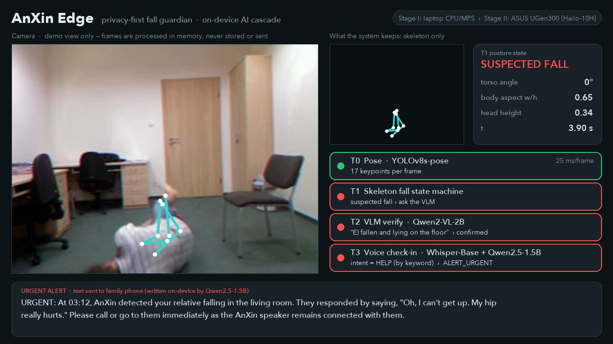
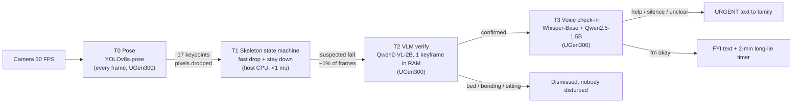

# AnXin Edge (安心) — privacy-first fall guardian on the ASUS UGen300

> **ASUS UGen AI League 2026 · Everyday AI · Battlefield Lightning (UGen300 / Hailo-10H)**

AnXin Edge watches over older adults who live alone. It detects a fall, **verifies** it, **asks the person** whether they are okay, and sends the family a **text-only** alert.
Four AI models run as a power-aware cascade on a single 2.5 W UGen300, and raw video never leaves the home.



## Why

* Falls kill about 684,000 people a year and are the 2nd leading cause of unintentional-injury death (WHO, 2021).
* For people living alone, the danger is the **long lie**: hours on the floor before anyone knows (Fleming & Brayne, BMJ 2008).
* Pendants are not worn at night or in the bathroom, cloud cameras feel like surveillance, and radar cannot verify or talk.

## How it works: a 4-tier cascade



| Tier | Model | Runs | Stage I backend | Stage II backend |
|---|---|---|---|---|
| T0 pose | YOLOv8s-pose (COCO-17) | every frame | Ultralytics, CPU/MPS | `yolov8s_pose.hef`, HailoRT InferModel |
| T1 fall FSM | rules on torso angle, aspect, head drop, dwell | every frame | Python | Python (Pi 5 CPU) |
| T2 verify | Qwen2-VL-2B-Instruct @ 336×336 | on suspicion | HF transformers | `Qwen2-VL-2B-Instruct.hef`, `genai.VLM` |
| T3 ASR | Whisper-Base | on confirmed fall | openai-whisper | `Whisper-Base.hef`, `genai.Speech2Text` |
| T3 LLM | Qwen2.5-1.5B-Instruct | on confirmed fall | HF transformers | `Qwen2.5-1.5B-Instruct.hef`, `genai.LLM` |

The pipeline code is identical on both paths: switch with `--backend cpu|hailo`. The Hailo code is adapted from the MIT-licensed [ugen300-demos](https://github.com/erp0917-stack/ugen300-demos) (see `anxin/backends/hailo_vendor/`).

**Safety design:** tiers can only escalate. A distress keyword always triggers an urgent alert, and so do silence and confused replies. The urgency label and next step come from rules; the LLM only phrases the message, so it cannot downgrade an emergency.

**Privacy design:** only the skeleton (rolling 3 s) and the alert text exist after processing. Frames and audio are handled in RAM and discarded.

## Stage I results: UR Fall Detection Dataset, 70 public clips

| | Falls detected (of 30) | False alarms (of 40 ADL) | Precision | Recall | Specificity | F1 |
|---|---|---|---|---|---|---|
| T1 skeleton only | 29 | 20 | 0.592 | 0.967 | 0.50 | 0.734 |
| **T1 + T2 VLM** | **29** | **2** | **0.935** | **0.967** | **0.95** | **0.951** |

* The VLM ran on 138 of 11,936 frames (**1.2%**). Pose took 28.5 ms/frame and the VLM about 1.0 s/call (Apple M3, MPS).
* Both remaining false alarms are deliberate floor activities (lying or crawling on the floor). The voice check-in resolves them ("I'm fine" → FYI only).
* Full per-clip output: `outputs/eval.json`.

Example messages written on-device by Qwen2.5-1.5B (`outputs/video/*.json`):

> **URGENT:** At 03:12, AnXin detected your relative falling in the living room. They responded by saying, "Oh, I can't get up. My hip really hurts." Please call or go to them immediately as the AnXin speaker remains connected with them.

> **FYI:** At 14:40, AnXin observed your relative fallen and lying on the floor in the study. The person responded, "I'm alright, I just slipped. Give me a minute." AnXin will continue to watch and will send an urgent alert if they remain on the floor for more than two minutes.

## Reproduce (about 15 minutes, no recording needed)

```bash
uv venv --python 3.11 .venv && uv pip install --python .venv/bin/python -r requirements.txt
./scripts/download_urfd.sh                      # 70 public URFD clips (~116 MB)
.venv/bin/python scripts/extract_pose.py        # T0 pose on every clip -> data/pose_cache/
.venv/bin/python scripts/tier1_check.py         # T1 only
.venv/bin/python scripts/evaluate.py            # T1 + T2 VLM -> outputs/eval.json
.venv/bin/python scripts/render_scenarios.py    # demo segments (live models) -> outputs/video/
.venv/bin/python -m anxin --video data/urfd/fall-01-cam0.mp4 --show
```

Stage II on a UGen300 (Pi 5 or Windows/Linux PC with HailoRT 5.x): put the `.hef` files from the Hailo Model Zoo / GenAI Model Zoo into `models/`, then run with `--backend hailo`.

## Repository layout

```
anxin/
  backends/pose.py     T0 pose (cpu | hailo)
  fall.py              T1 tracker + skeleton fall state machine
  backends/vlm.py      T2 Qwen2-VL verifier (cpu | hailo)
  backends/genai.py    T3 Whisper + Qwen2.5 LLM (cpu | hailo)
  checkin.py           voice check-in, safety rules, caregiver message
  pipeline.py          the cascade
  dashboard.py         demo / live dashboard renderer
scripts/               dataset download, pose cache, evaluation, demo rendering, video assembly
```

## Stage II plan (Nov 6 – Dec 4)

1. Port the 4 `.hef` models to UGen300 + Raspberry Pi 5; measure FPS, latency, power.
2. Live loop: camera, speaker-mic check-in, LINE/Telegram alert relay, long-lie timer.
3. Robustness: Le2i cross-dataset test, low light (Zero-DCE on Hailo), multiple people, zh-TW voice.
4. Performance report, documentation, 10-minute demo on the UGen300.

## Data, models and licences

* UR Fall Detection Dataset: B. Kwolek, M. Kepski, *Human fall detection on embedded platform using depth maps and wireless accelerometer*, CMPB 117(3), 2014. Downloaded by script and not redistributed.
* YOLOv8 (Ultralytics, AGPL-3.0), Qwen2-VL / Qwen2.5 (Apache-2.0), Whisper (MIT), Hailo Model Zoo.
* The demo video's elderly reply audio is synthesised with macOS TTS, because the dataset has no audio. Every other on-screen output is produced live by the models.

MIT License © 2026 Team AnXin
